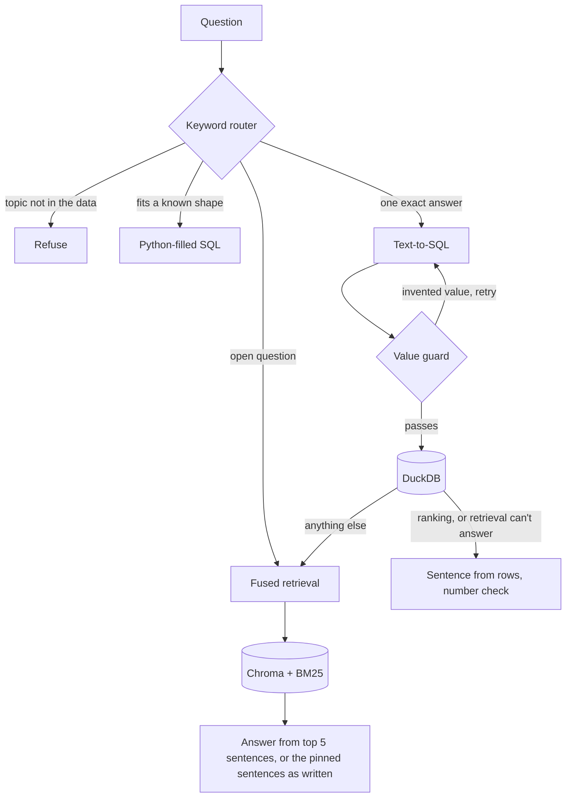

# F1 RAG

A question-answering system over Formula 1 data from 1950 to 2026. It combines text-to-SQL with hybrid retrieval behind a keyword router, and it runs entirely on a laptop CPU at no cost: no paid APIs, no GPU and no framework.

Each part is built without a framework so it can be measured on its own, and each notebook builds on what the one before it measured.

**Result:** on the latest 30 new questions, written blind to the code, the system answered 18 correctly and gave 9 wrong answers. Retrieval alone got 20 right. An earlier set, worded closer to the system's own phrasing, scored 27 right and 3 wrong. Changes made since the latest run haven't been scored yet.

## How it works



| Part | What it does | Code |
|---|---|---|
| Router | Regex rules choose a path and refuse topics the data doesn't cover | `src/router.py` |
| Templates | Parse fixed question shapes and fill the SQL in Python, with no model | `src/templates.py` |
| Text-to-SQL | Short prompt, plus only the hints this question needs | `src/text_to_sql.py` |
| Value guard | Rejects SQL containing names or numbers the question never mentioned | `src/text_to_sql.py` |
| Retrieval | Dense and BM25 search merged with reciprocal rank fusion | `src/retriever.py` |
| Live data | Pulls the current season from the Jolpica API and merges it | `src/live_data.py` |
| Extra data | Adds 612 sprint results and 12,913 pit stops from the same API | `src/extra_data.py` |
| Corpus | Turns 26,269 result rows, the standings and summaries of each race, driver, team and circuit into 32,555 sentences | `src/text_gen.py` |

## Results

Each evaluation used 30 questions committed after the code and before any run, with live 2026 data through round 18. The same questions ran through the earlier version and the current code, so the two can be compared directly.

The fifth set was written by a separate agent that saw the schema and the corpus but not the code, the README or any results. Its wording was looser than the four sets before it, and the score fell:

| Pipeline | Holdout 4 | Holdout 5 |
|---|---|---|
| SQL only | 12 right, 9 wrong | 10 right, 10 wrong |
| Vector only | 19 right, 5 wrong | **20 right, 6 wrong** |
| Hybrid | **27 right, 3 wrong** | 18 right, 9 wrong |

| Holdout 5 by type | SQL | Vector | Hybrid |
|---|---|---|---|
| Single fact (8) | 5 | 8 | 7 |
| Aggregate (9) | 1 | 2 | 2 |
| Narrative (7) | 0 | 4 | 4 |
| Unanswerable (6) | 4 | 6 | 5 |

Templates answered 13 of holdout 4 but only 2 of holdout 5, because words like "altogether", "crowned" or a middle name made them decline. Text-to-SQL then took those questions and answered six of them wrongly. That is why the hybrid lost to retrieval alone. Three changes since then answer those findings, and the next blind set will score them:

- Templates accept looser wording, middle names, and wins at a named race or circuit. They now answer 120 of all 258 questions, each with its expected value.
- Pinned sentences answer any open question, not only ones that start "Tell me about".
- A sentence-backed answer wins over model-written SQL, except for rankings (see below).

Earlier frozen sets rose from 14 right to 27, from 21 to 25, from 20 to 26 and from 23 to 27, each measuring a round of changes. Those sets were written in phrasing close to the system's own, so they overstated how it handles new wording.

On holdout 5, search alone found the answer sentence for 10 of 15 questions, and 13 of 15 with pinned sentences.

Scoring checks that each answer contains the expected fact. Each set ran once, so these scores show direction rather than a precise rate.

## Design decisions

**Sentences built from tables, not scraped text.** Every sentence comes from a database row, so retrieved context can be traced to its source. The cost is a corpus of near-identical sentences, which is hard on embeddings, so each race also gets one summary sentence naming its circuit, winner, pole sitter and podium.

**Templates before the model.** Who won, who was on pole and how many wins all follow fixed shapes, so Python parses them and fills the SQL. A template must account for every word of the question, and any word it doesn't recognise sends the question to the model instead.

**Sentence-backed answers over model-written SQL.** Model-written SQL runs without error even when it asks the wrong thing, and holdout 5 showed it answering counts wrongly with confidence. A retrieval answer must use only numbers from sentences built from the tables, so it wins when it gives one. On the 47 questions that took the SQL path across six runs, that choice would have scored 36 right and 10 wrong instead of 29 and 16. Rankings stay with SQL, because no sentence holds one: there SQL got 4 of 5 and retrieval 2.

**One team, however many names.** Early entries pair chassis and engine, so Cooper appears under 10 names and an exact match gave it 2 wins instead of 16. Names are grouped into teams for counts and rankings. Team Lotus, the 2010-2011 Lotus team and Lotus F1 stay separate, and a question about "Lotus" alone counts all three and says so.

**Overviews are derived, not retrieved from race rows.** 88% of the original corpus was per-car race results, so "Tell me about Niki Lauda" had no sentence to find. One sentence per driver, team and circuit now holds those totals, and the question's subject pins it into the context. An open question about a pinned subject gets those sentences back as written, because a paraphrase from the model can drop their main facts. A lone surname pins only when capitalised, so "I'd love some background" doesn't pin the driver John Love.

**Status, not position, says what happened.** Every result row has a position, even a retirement, so sentences are built from `status`. That turns a misleading "finished 20th" into "retired (Collision)".

**Two paths, not one.** Notebook 4 showed retrieval can't answer "most wins for Ferrari in the 2000s": no single sentence holds a total. Notebook 5 showed SQL can't summarise a driver's season. Each path covers the other's weakness.

**BM25 fused with dense search.** In these sentences, exact names and years matter more than meaning. On a 34-hit retrieval test, dense search scored 15, BM25 28 and fusion 29. Reciprocal rank fusion uses ranks alone, so the two score scales never need calibrating.

**A keyword router, not an LLM.** Regex rules are instant, free, testable and explainable. An LLM router would put a slow step in front of every question.

**Definitions live in Python.** Pole position is `grid = 1`, because `f1_qualifying` starts in 1994 and gives Senna 3 poles instead of 65. A small semantic layer adds that hint only when the question needs it.

**Guards in code, not in the prompt.** Python refuses topics the data lacks, allows `how many` only for things the tables count, rejects invented values and verifies numbers in the final sentence. These checks behave the same way every time, and most bad queries run without error, so only a check outside the model catches them.

**Replace the whole season, in one transaction.** The 2026 calendar changed from 22 to 23 rounds while the snapshot was stale, so appending would have kept wrong rows. Rounds already stored must match the API, or the merge stops. A full index rebuild takes minutes and can't leave the corpus and Chroma out of step.

**Freeze the code, then write the test.** Each evaluation's questions were committed after the code and before any run, so the history shows nothing was tuned on them. Comparing versions on the same new questions keeps the gain measurable.

## What I'd do next

1. Score the changes since holdout 5 on a new set written blind to the code.
2. Answer "which driver scored the most points in a season" from the standings. Text-to-SQL ranks constructors for it, because its one example does.
3. Add lap-by-lap data from the same API to answer questions about laps led.
4. Test a larger local model on new questions.

## Run it

You need Python 3.12 and [Ollama](https://ollama.com). Download the Kaggle dataset "Formula 1 Complete History" and put its 8 CSVs in `data/raw/`.

```bash
python -m venv venv
source venv/bin/activate        # Windows: .\venv\Scripts\Activate.ps1
pip install -r requirements.txt
ollama pull llama3.2:3b
```

Run these notebooks in order to build the data:

1. `01_schema_and_sql` loads the CSVs into DuckDB.
2. `02_text_generation` writes the corpus.
3. `04_naive_rag` builds the Chroma index.
4. `07_jolpica_live_data` adds the current season. It's safe to run again.

Then add sprints and pit stops with `python -m src.extra_data` and fix source names with `python -m src.clean_data`. Both are safe to repeat. Run notebook 07 once more to rewrite the corpus and index with them.

Then ask a question from the repo root:

```python
from src.router import ask

result = ask("Who won the 2021 Abu Dhabi Grand Prix?")
print(result["path"], result["answer"])
```

Set `F1_OLLAMA_URL` if Ollama isn't at `http://localhost:11434`. Run the checks with:

```bash
python tests/test_templates.py
python tests/test_literal_guard.py
python tests/test_live_data.py
python tests/test_text_gen.py
```

Score a question set with SQL only, vector only and the hybrid. `--code` points at another checkout to score an earlier version on the same questions:

```bash
python eval/run_holdout.py holdout4 eval/results_holdout4_new.json
```

## Repo layout

| Path | Contents |
|---|---|
| `notebooks/` | The project in order, one concept each (see below) |
| `src/` | Reusable pipeline code |
| `tests/` | Plain Python checks, including real SQL the model produced |
| `eval/` | 258 questions across 11 sets, every recorded result, and the runner that scores a set |

| Notebook | Topic | Main finding |
|---|---|---|
| 01 | Schema and SQL | The dataset's real columns differ from classic Ergast |
| 02 | Rows to sentences | 28,315 sentences from structured data |
| 03 | Embeddings | Cosine similarity by hand and a UMAP of the corpus |
| 04 | Naive RAG | Vocabulary mismatch and coverage gaps |
| 05 | Text-to-SQL | Selected hints beat long prompts |
| 06 | Hybrid router | BM25 gave retrieval its biggest gain |
| 06b | Value guard | Hybrid beats retrieval for the first time |
| 07 | Live data | 15 more rounds of 2026 through a validated merge |
| 08 | Final evaluation | Retrieval, generation and end-to-end scored separately |

Notebooks 05 to 08 record their own runs, and `src/` and the corpus changed afterwards, so re-running them gives different numbers. The latest results are in `eval/results_holdout5_*.json`.

## Stack

DuckDB for analytical SQL, ChromaDB for vectors, `rank_bm25` for keyword search, `all-MiniLM-L6-v2` for embeddings and Ollama with `llama3.2:3b` for generation. Data comes from Kaggle and the free [Jolpica API](https://api.jolpi.ca/ergast/f1/).
