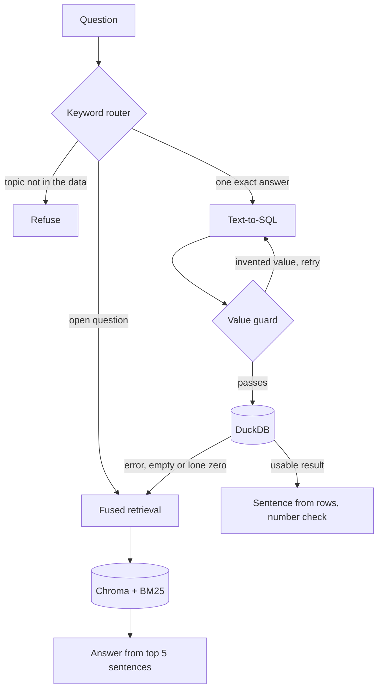

# F1 RAG

A question-answering system over Formula 1 data from 1950 to 2026. It combines text-to-SQL with hybrid retrieval behind a keyword router, and it runs entirely on a laptop CPU at no cost: no paid APIs, no GPU and no framework.

Each part is built without a framework so it can be measured on its own, and each notebook builds on what the one before it measured.

**Result:** on 30 new questions, the hybrid system answered 21 correctly, beating SQL alone (19) and retrieval alone (16).

## How it works



| Part | What it does | Code |
|---|---|---|
| Router | Regex rules choose a path and refuse topics the data doesn't cover | `src/router.py` |
| Text-to-SQL | Short prompt, plus only the hints this question needs | `src/text_to_sql.py` |
| Value guard | Rejects SQL containing names or numbers the question never mentioned | `src/text_to_sql.py` |
| Retrieval | Dense and BM25 search merged with reciprocal rank fusion | `src/retriever.py` |
| Live data | Pulls the current season from the Jolpica API and merges it | `src/live_data.py` |
| Corpus | Turns 26,269 result rows and the standings tables into 28,646 sentences | `src/text_gen.py` |

## Results

The final evaluation used 30 questions written after the code was committed, with live 2026 data through round 18.

| Pipeline | Right | Wrong | Refused |
|---|---|---|---|
| SQL only | 19 | 6 | 5 |
| Vector only | 16 | 4 | 10 |
| **Hybrid** | **21** | 5 | 4 |

| Question type | SQL | Vector | Hybrid |
|---|---|---|---|
| Single fact (10) | 8 | 4 | 7 |
| Aggregate (8) | 5 | 1 | 5 |
| Narrative (5) | 1 | 4 | 4 |
| Unanswerable (7) | 5 | 7 | 5 |

Scoring each stage separately shows where the failures come from:

| Stage | Score |
|---|---|
| Retrieval: answer sentence in the top 5 | Dense 7/15, BM25 8/15, fused 9/15 |
| Generation: model given the right sentence | 14/15 |

So retrieval limits the vector path, not the model. Four of the six retrieval misses are "who won" or "on pole" questions, because the corpus says "1st (winner)" and "starting from position 1".

Each of the 30 questions ran once, so these scores show direction rather than a precise rate.

## Design decisions

**Sentences built from tables, not scraped text.** Every sentence comes from a database row, so retrieved context can be traced to its source. The cost is a corpus of near-identical sentences, which is hard on embeddings.

**Two paths, not one.** Notebook 4 showed retrieval can't answer "most wins for Ferrari in the 2000s": no single sentence holds a total. Notebook 5 showed SQL can't summarise a driver's season. Each path covers the other's weakness.

**BM25 fused with dense search.** In these sentences, exact names and years matter more than meaning. On a 34-hit retrieval test, dense search scored 15, BM25 28 and fusion 29. Reciprocal rank fusion uses ranks alone, so the two score scales never need calibrating.

**A keyword router, not an LLM.** Regex rules are instant, free, testable and explainable. An LLM router would put a slow step in front of every question.

**Definitions live in Python.** Pole position is `grid = 1`, because `f1_qualifying` starts in 1994 and gives Senna 3 poles instead of 65. A small semantic layer adds that hint only when the question needs it.

**Guards in code, not in the prompt.** Python refuses topics the data lacks, rejects invented values and verifies numbers in the final sentence. These checks behave the same way every time, and most bad queries run without error, so only a check outside the model catches them.

**Replace the whole season, in one transaction.** The 2026 calendar changed from 22 to 23 rounds while the snapshot was stale, so appending would have kept wrong rows. Rounds already stored must match the API, or the merge stops. A full index rebuild takes minutes and can't leave the corpus and Chroma out of step.

**Freeze the code, then write the test.** The final evaluation's questions were written after the code was committed, so nothing was tuned on them.

## What I'd do next

1. Add win-phrased sentences, such as "Max Verstappen won the 2021 Abu Dhabi Grand Prix", the likeliest fix for retrieval misses.
2. Use SQL templates filled by Python, with the model only choosing the template, to remove most wrong counts.
3. Test a larger local model on these same questions.
4. Add a cross-encoder reranker and circuit name aliases.

## Run it

You need Python 3.12 and [Ollama](https://ollama.com). Download the Kaggle dataset "Formula 1 Complete History" and put its 8 CSVs in `data/raw/`.

```bash
python -m venv venv
source venv/bin/activate        # Windows: .\venv\Scripts\Activate.ps1
pip install -r requirements.txt
ollama pull llama3.2:3b
```

Run these notebooks in order to build the data:

1. `01_schema_and_sql` loads the CSVs into DuckDB.
2. `02_text_generation` writes the corpus.
3. `04_naive_rag` builds the Chroma index.
4. `07_jolpica_live_data` adds the current season. It's safe to run again.

Then ask a question from the repo root:

```python
from src.router import ask

result = ask("Who won the 2021 Abu Dhabi Grand Prix?")
print(result["path"], result["answer"])
```

Set `F1_OLLAMA_URL` if Ollama isn't at `http://localhost:11434`. Run the checks with:

```bash
python tests/test_literal_guard.py
python tests/test_live_data.py
python tests/test_text_gen.py
```

## Repo layout

| Path | Contents |
|---|---|
| `notebooks/` | The project in order, one concept each (see below) |
| `src/` | Reusable pipeline code |
| `tests/` | Plain Python checks, including real SQL the model produced |
| `eval/` | 108 questions across 6 sets, plus every recorded result |

| Notebook | Topic | Main finding |
|---|---|---|
| 01 | Schema and SQL | The dataset's real columns differ from classic Ergast |
| 02 | Rows to sentences | 28,315 sentences from structured data |
| 03 | Embeddings | Cosine similarity by hand and a UMAP of the corpus |
| 04 | Naive RAG | Vocabulary mismatch and coverage gaps |
| 05 | Text-to-SQL | Selected hints beat long prompts |
| 06 | Hybrid router | BM25 gave retrieval its biggest gain |
| 06b | Value guard | Hybrid beats retrieval for the first time |
| 07 | Live data | 15 more rounds of 2026 through a validated merge |
| 08 | Final evaluation | Retrieval, generation and end-to-end scored separately |

Notebooks 05 and 06 record their own runs, and `src/` changed afterwards, so re-running them gives different numbers.

## Stack

DuckDB for analytical SQL, ChromaDB for vectors, `rank_bm25` for keyword search, `all-MiniLM-L6-v2` for embeddings and Ollama with `llama3.2:3b` for generation. Data comes from Kaggle and the free [Jolpica API](https://api.jolpi.ca/ergast/f1/).
